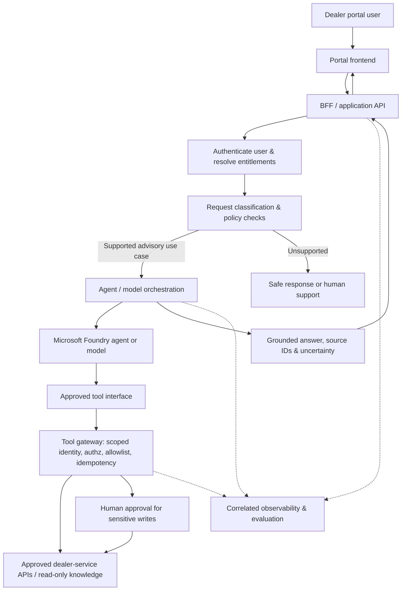

# Dealer advisory agent: reference architecture

**Illustrative only:** enterprise's actual architecture, approved knowledge, APIs, identities, region and policies were not provided. All names and stores here are generic. Implement only after the team confirms real contracts.

## Boundaries

| Boundary | Enforcement and evidence |
|---|---|
| User -> API | Entra/OIDC session verification as appropriate, TLS, tenant/dealer context, request size/rate limits, no trusting UI role claims |
| API -> model | Server-side prompt composition, permitted data scope, content classification, model deployment choice, timeouts and budget controls |
| Model -> tools | Versioned tool schema, allowlisted functions, parameter validation, scopes, server-side authorization, explicit approval on writes |
| Tools -> backend | Domain API ownership, transaction controls, idempotency key, concurrency checks, rollback/compensation if appropriate |
| Knowledge -> answer | Approved references with stable IDs, freshness review, response citations; abstain/escalate when insufficient evidence |
| Any hop -> telemetry | Correlation IDs, safe attributes, restricted trace access, redaction and retention schedule |

## Decision points

- Start with read-only information retrieval and supported-question handling before considering changes to dealer or account records.
- Use deterministic routing and validation for actions where a model would only add ambiguity.
- A model may classify user intent, choose an approved search tool or summarize retrieved content. It must not define user rights, issue entitlements, or approve financial/transactional actions.
- Distinguish synchronous request/response from durable tasks that take minutes or hours. Long-running tasks require persisted state, recovery, replay and operations ownership.
- Evaluate the whole user action and the tool path; a fluent response is not proof that the action was authorized or completed.

## In the offline exercise

The [dealer-support lab](../06-reference-lab/README.md) implements only the *request validation -> deterministic routing -> approved synthetic catalog -> concise answer* portion. It does **not** implement Entra, Foundry, external MCP, real dealer data or long-running work. These are explicit integration boundaries, not hidden TODOs in the demo.
